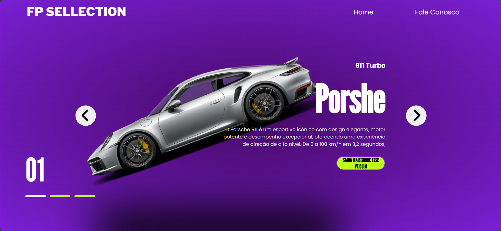
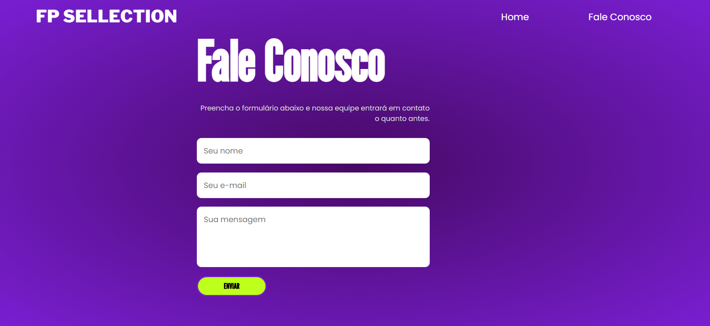

# Projeto Web Básico

Este repositório contém um site simples em HTML, CSS e JavaScript.

## Visual

Home:

Fale Conosco:

## Estrutura

- `index.html`
- `contact.html`
- `styles.css`
- `script.js`
- `img/` (imagens do projeto)

## Como visualizar

Abra `index.html` no navegador ou use um servidor local (ex.: `npx serve`).

## Autor

[Matheus Alberto](https://github.com/mathalber)
